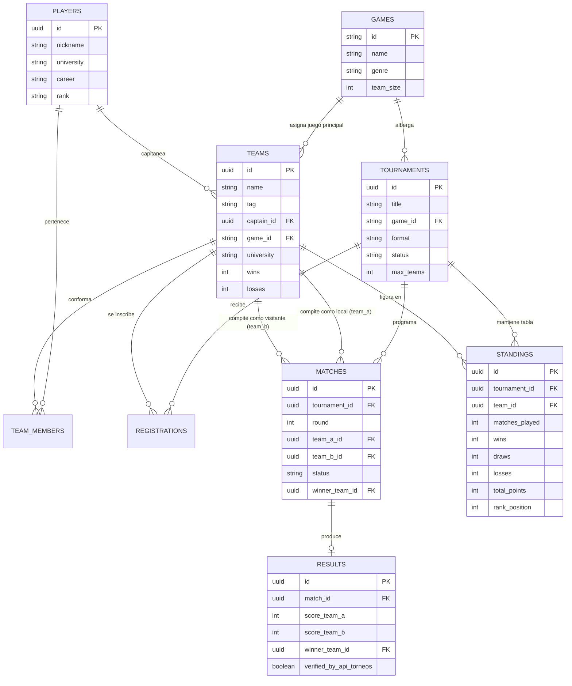

# INFORME ACADÉMICO DEL PROYECTO: UNIE-SPORTS

## 1. Nombre del Proyecto
**UniE-Sports: Plataforma Universitaria de Gestión de Torneos y Clasificaciones de Videojuegos Competitivos**

## 2. Descripción General
UniE-Sports es una solución web construida bajo el paradigma de **Arquitectura Orientada a Servicios (SOA)** que centraliza la administración de ligas de eSports en el ámbito universitario. Permite registrar instituciones, equipos y jugadores, programar partidas bajo el formato de liguilla (round-robin), validar y registrar marcadores en tiempo real mediante colaboración inter-servicio HTTP, y calcular clasificaciones y estadísticas auditables.

---

## 3. Planteamiento del Problema
En los entornos universitarios, los torneos de videojuegos competitivos suelen organizarse mediante hojas de cálculo manuales o herramientas comerciales cerradas no interoperables. Esto genera:
1. **Falta de integración:** Dificultad para que otras facultades o grupos de desarrollo consuman datos de partidas o calendarios.
2. **Inconsistencias en los marcadores:** Errores humanos al computar victorias, empates y diferencias de puntos o rondas.
3. **Acoplamiento monolítico:** Los sistemas tradicionales mezclan la lógica de torneos con la lógica de clasificación, impidiendo escalar o evolucionar independientemente los servicios.

---

## 4. Objetivos

### 4.1. Objetivo General
Diseñar e implementar una plataforma web modular bajo una Arquitectura Orientada a Servicios (SOA) compuesta por dos APIs REST desacopladas y un frontend responsivo, orientada a la gestión integral de torneos universitarios de deportes electrónicos.

### 4.2. Objetivos Específicos
1. Desarrollar el servicio `api-torneos` para la administración de videojuegos, jugadores, equipos, inscripciones y calendario de partidas.
2. Desarrollar el servicio `api-resultados` para el registro verificado de resultados, cómputo dinámico de tablas de posiciones (standings) y estadísticas.
3. Implementar un protocolo de **comunicación HTTP sincrónica** entre ambas APIs donde `api-resultados` valide la existencia y estado de cada enfrentamiento en `api-torneos` antes de asentar un resultado.
4. Construir una interfaz web en Next.js, React, TypeScript y Tailwind CSS con estética competitiva de eSports y documentación Swagger/OpenAPI interactiva.
5. Diseñar el modelo de persistencia en PostgreSQL / Supabase aplicando políticas de seguridad Row Level Security (RLS) y preparar el despliegue gratuito en Vercel y GitHub.

---

## 5. Justificación Técnica y de Arquitectura SOA
El proyecto toma como referencia el diseño arquitectónico del docente (`didierguerreros/coordinacion-emergencia`), en el cual dos servicios (`api-emergencias` y `api-ubicacion`) operan de manera autónoma y se comunican vía HTTP para resolver un caso de uso compuesto.

En UniE-Sports, la separación en dos servicios resuelve problemas fundamentales:
- **Autonomía:** `api-torneos` puede actualizar su lógica de programación de brackets o formatos de torneo sin alterar el algoritmo matemático de puntuación de `api-resultados`.
- **Reutilización:** Otros proyectos universitarios (e.g., una aplicación móvil de la universidad o un bot de Discord) pueden consumir exclusivamente el endpoint de clasificaciones (`api-resultados`) o el catálogo de partidas (`api-torneos`) sin dependencias innecesarias.
- **Trazabilidad y Seguridad:** Ningún resultado puede insertarse de forma arbitraria; `api-resultados` actúa como guardián de integridad al verificar los contratos de `api-torneos`.

---

## 6. Modelo Entidad-Relación (MER)

---

## 7. Casos de Uso Principales

### CU-01: Creación y Gestión de Torneos
- **Actor:** Administrador / Organizador
- **Servicio:** `api-torneos`
- **Flujo:** El organizador define el título, juego, formato (liguilla) y cupo de equipos. El torneo queda en estado `open`.

### CU-02: Inscripción de Equipos
- **Actor:** Capitán de Equipo
- **Servicio:** `api-torneos`
- **Flujo:** El capitán registra su escuadra con etiqueta (tag) institucional y formaliza su registro en el torneo.

### CU-03: Generación de Enfrentamientos y Fixture
- **Actor:** Administrador
- **Servicio:** `api-torneos`
- **Flujo:** Una vez completado el cupo, el sistema genera automáticamente las rondas todos contra todos (`matches`) en estado `scheduled`.

### CU-04: Registro y Validación Inter-Servicio de Marcadores
- **Actor:** Árbitro / Administrador
- **Servicios involucrados:** `api-resultados` <--> `api-torneos`
- **Flujo:**
  1. El árbitro envía el marcador final mediante la aplicación web.
  2. `api-resultados` realiza petición HTTP `GET /api/v1/matches/{id}` a `api-torneos`.
  3. `api-torneos` certifica que la partida existe, está en estado `scheduled` y pertenece al torneo.
  4. `api-resultados` registra el marcador y envía petición HTTP `PATCH /api/v1/matches/{id}` para marcarla `completed`.
  5. `api-resultados` recalcula inmediatamente la tabla de posiciones asignando 3 puntos al vencedor (o 1 en caso de empate reglamentario).

---

## 8. Evidencia de Pruebas y Validación
El sistema cuenta con un suite automatizado en Vitest que comprueba:
1. `GET /api/v1/tournaments` y `GET /api/v1/matches/{id}` responden en formato estándar.
2. Validación de rechazo HTTP 404 cuando se intenta registrar un resultado para una partida inexistente.
3. Validación de rechazo HTTP 400 cuando se intenta registrar un resultado duplicado o sobre una partida ya finalizada.
4. Éxito de la llamada HTTP inter-servicio con actualización verificada del puntaje en `standings`.
