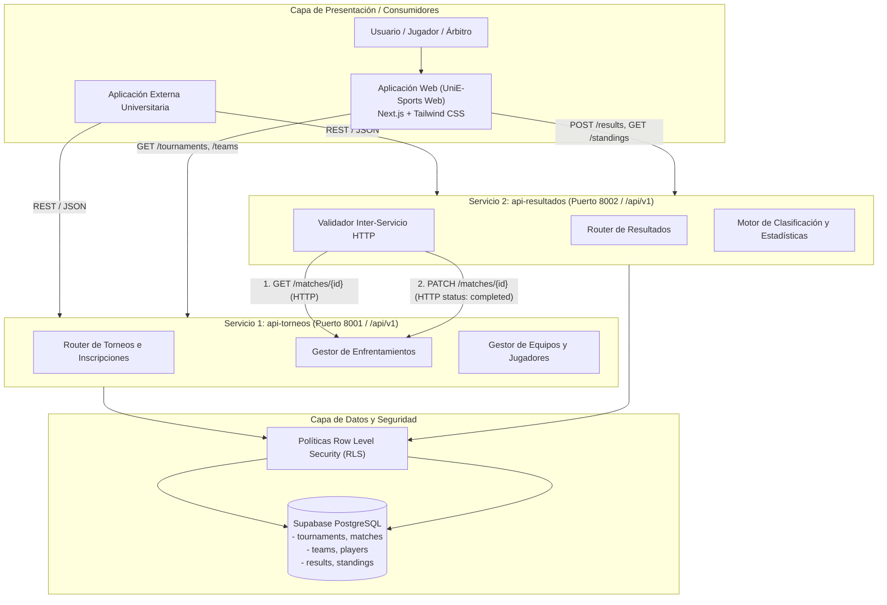
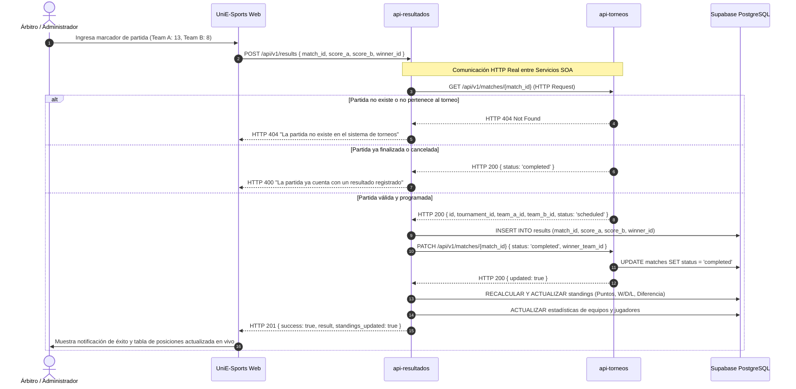

# Arquitectura del Sistema UniE-Sports (SOA)

## 1. Visión General
**UniE-Sports** es una plataforma universitaria para la gestión de deportes electrónicos y torneos competitivos basada en una **Arquitectura Orientada a Servicios (SOA)**.

Inspirado en la separación estructural del repositorio docente `coordinacion-emergencia` (`api-emergencias`, `api-ubicacion`, `web`), UniE-Sports desacopla estrictamente:
- **`api-torneos`**: Gestión del ciclo de vida de competiciones, catálogo de videojuegos, jugadores, equipos, inscripciones y generación de enfrentamientos.
- **`api-resultados`**: Registro de marcadores, validación inter-servicio mediante HTTP, cálculo de tablas de posiciones (standings) y estadísticas.
- **`web`**: Aplicación web moderna para jugadores, capitanes, árbitros y espectadores con interfaz competitiva de eSports.
- **`Supabase`**: Base de datos relacional PostgreSQL con políticas de seguridad a nivel de fila (RLS) y autenticación.

---

## 2. Diagrama de Arquitectura SOA

---

## 3. Flujo Obligatorio de Comunicación Inter-Servicios (Caso de Uso Principal)

---

## 4. Contratos de las APIs REST

### 4.1. `api-torneos`
| Método | Endpoint | Descripción | Acceso |
| :--- | :--- | :--- | :--- |
| `GET` | `/api/v1/games` | Catálogo de videojuegos soportados | Público |
| `GET` | `/api/v1/tournaments` | Listado de torneos con filtros (juego, estado) | Público |
| `GET` | `/api/v1/tournaments/:id` | Detalle del torneo, reglas y formato | Público |
| `POST` | `/api/v1/tournaments` | Creación de nuevo torneo | Protegido (Admin) |
| `PATCH` | `/api/v1/tournaments/:id` | Actualización de estado del torneo | Protegido (Admin) |
| `GET` | `/api/v1/teams` | Directorio de equipos universitarios | Público |
| `POST` | `/api/v1/teams` | Registro de nuevo equipo | Autenticado |
| `GET` | `/api/v1/players` | Catálogo de jugadores y perfiles | Público |
| `POST` | `/api/v1/players` | Registro de nuevo jugador | Autenticado |
| `POST` | `/api/v1/tournaments/:id/registrations` | Inscripción de equipo a torneo | Autenticado |
| `GET` | `/api/v1/tournaments/:id/matches` | Lista de enfrentamientos del torneo | Público |
| `GET` | `/api/v1/matches/:id` | Consulta de partida individual (usada por api-resultados) | Público / SOA |
| `PATCH` | `/api/v1/matches/:id` | Actualización de estado de la partida | SOA / Admin |
| `POST` | `/api/v1/tournaments/:id/generate-matches` | Generador automático de fixture liguilla | Protegido (Admin) |

### 4.2. `api-resultados`
| Método | Endpoint | Descripción | Acceso |
| :--- | :--- | :--- | :--- |
| `POST` | `/api/v1/results` | Registro de resultado con validación HTTP contra `api-torneos` | Protegido (Árbitro/Admin) |
| `GET` | `/api/v1/results` | Historial general de resultados | Público |
| `GET` | `/api/v1/results/:id` | Detalle de un resultado específico | Público |
| `GET` | `/api/v1/tournaments/:id/standings` | Tabla de posiciones calculada de un torneo | Público |
| `GET` | `/api/v1/teams/:id/statistics` | Estadísticas acumuladas de un equipo | Público |
| `GET` | `/api/v1/players/:id/statistics` | Estadísticas individuales de un jugador | Público |
| `GET` | `/api/v1/teams/:id/history` | Historial de enfrentamientos de un equipo | Público |

---

## 5. Estrategia de Despliegue en Niveles Gratuitos
- **GitHub**: Repositorio único monorepo modular con carpetas `api-torneos`, `api-resultados`, `web` y `database`.
- **Vercel**: Despliegue con Serverless Functions y Next.js App Router. Cada endpoint `/api/v1/*` es servido por su respectivo módulo desacoplado.
- **Supabase**: Base de datos PostgreSQL alojada en el Free Tier con conexión por pooler transaccional, SSL y RLS activo.
- **Resiliencia Offline / Mock Store**: En caso de no configurar de inmediato las credenciales de Supabase, el sistema cuenta con un motor de almacenamiento en memoria con datos presembrados idénticos a `database/seed.sql`, garantizando que las pruebas y la navegación funcionen al 100%.
